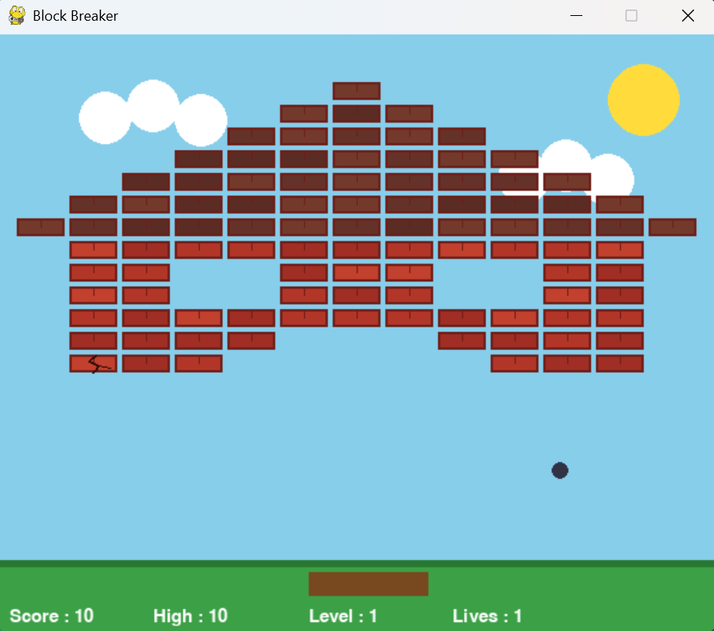
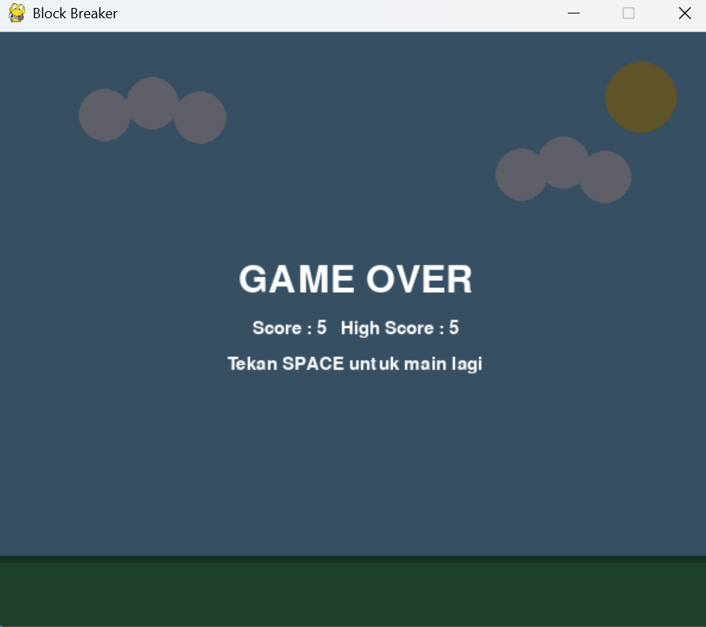

# Block Breaker: Perubahan dari Kode Awal ke Versi Akhir

## Ringkasan

| Aspek | Kode awal | Versi akhir |
|---|---|---|
| Susunan blok | Grid penuh di setengah layar atas | Berbentuk rumah (atap, dinding, jendela, pintu) |
| Tampilan blok | Kotak polos putih/hijau | Batu bata merah, retak setelah pukulan pertama |
| Ketahanan blok | Putih 2 pukulan, hijau 1 pukulan | Semua blok 2 pukulan |
| Latar | Hitam polos | Langit, matahari, awan, rumput |
| Layar game over | Tanpa tulisan (layar membeku di frame terakhir) | Tulisan GAME OVER, skor, high score |
| Level dan high score | Tidak ada | Ada |

## 1. Perbaikan bug

1. **Reset bola.** Awalnya bola kembali ke pojok kiri bawah. Sekarang bola muncul di tengah dan bergerak ke atas dengan arah kiri atau kanan acak (`Ball.reset`).
2. **Layar game over tanpa tulisan.** Awalnya layar membeku di frame terakhir tanpa informasi apa pun. Fungsi `gameOver` sekarang menampilkan tulisan dan petunjuk menekan SPACE. Loop-nya juga memakai `clock.tick` agar tidak membebani CPU.
3. **Menghapus blok saat iterasi.** Awalnya blok dihapus dari list yang sedang di-loop. Sekarang loop memakai salinan list dan berhenti setelah satu blok terkena, jadi bola tidak memantul dua kali sekaligus.
4. **Bola nyangkut di paddle.** Pantulan paddle hanya terjadi saat bola sedang turun (`yFac > 0`).
5. **Bola nyangkut di dinding.** Posisi bola dijepit di batas layar saat memantul (`Ball.update`).
6. **Tabrakan telat satu frame.** `Ball.getRect()` membuat rect dari posisi bola saat ini. Sebelumnya memakai rect dari frame sebelumnya.
7. **Teks skor dan nyawa telat satu frame.** Teks digambar setelah nilainya diperbarui lewat fungsi baru `drawHud`.
8. **Pukulan terhitung dua kali.** Setelah kena blok, bola didorong keluar dari blok sebelum memantul.
9. **Debug dihapus.** `print(lives)` dihilangkan.

## 2. Fitur baru

- **Level.** Setelah semua blok hancur, level naik dan kecepatan bola bertambah 1 (maksimal 10). Konstanta: `BASE_BALL_SPEED` dan `MAX_BALL_SPEED`.
- **High score.** Tersimpan selama program berjalan dan tidak disimpan ke file.
- **HUD.** Menampilkan Score, High, Level, dan Lives di bagian bawah layar.
- **Posisi awal.** Paddle dan bola mulai di tengah layar.

## 3. Batu bata

- Semua blok memakai health 200. Pukulan pertama membuat bata retak, pukulan kedua menghancurkannya dan menambah skor 5.
- `Block.display` menggambar bata dengan tepi gelap dan garis sambungan kecil.
- `Block.drawCrack` (baru) menggambar garis retakan zig-zag setelah pukulan pertama.
- Konstanta `WHITE`/`GREEN` untuk jenis blok diganti `BRICK_COLORS`, `MORTAR_COLOR`, dan `CRACK_COLOR`.

## 4. Tema rumah

- **`HOUSE_MAP`** (baru): denah teks (`#` = bata, `.` = kosong) untuk bentuk rumah, berisi 101 blok. Bentuk rumah bisa diubah dengan mengedit denah ini.
- **`populateBlocks`** ditulis ulang untuk membaca denah, dengan rumah di tengah layar. Tujuh baris teratas diwarnai sebagai atap (`ROOF_COLORS`).
- **Celah antar blok** diperkecil dari 20 menjadi 4 piksel.
- **`drawBackground`** (baru): menggambar langit, matahari, awan, dan rumput. Dipakai di game dan di layar game over, yang diberi lapisan gelap transparan.
- **Warna bola dan paddle** diganti (bola abu gelap, paddle cokelat) agar kontras dengan latar.

## Fungsi dan class

| Nama | Status |
|---|---|
| `Striker` | Pengubahan kecil (hanya gambar paddle) |
| `Block` | Diubah (health, tampilan bata) + `drawCrack` baru |
| `Ball` | Diubah (`reset`, `update`, `getRect`) |
| `populateBlocks` | Ditulis ulang (bentuk rumah) |
| `drawBackground` | Baru |
| `drawHud` | Baru |
| `gameOver` | Diubah (menampilkan layar, menerima skor) |
| `main` | Diubah (level, high score, urutan gambar) |

## Catatan

- Bola dan paddle bisa lewat di celah jendela dan pintu rumah.
- Setiap naik level, rumah yang sama muncul lagi dengan bola lebih cepat.
- Tampilan sudah diperiksa lewat render satu frame, tapi gameplay penuh belum diuji di lingkungan pengembangan ini.